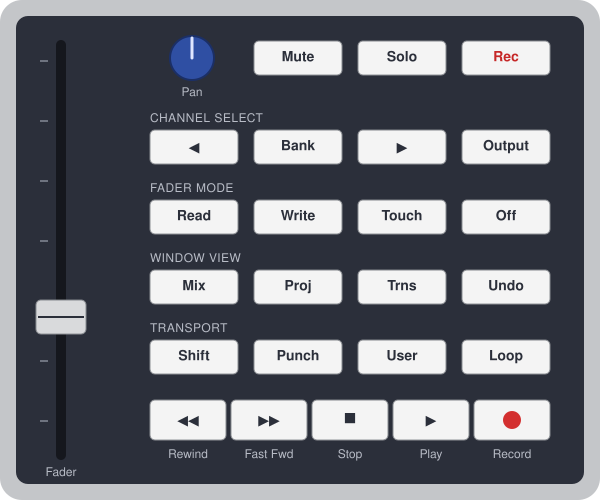

# 4irmann's FaderPort Driver for REAPER: Manual

Version 2.0.0. Copyright 2010-2026 Matthias Ehrmann (aka 4irmann), Apache License 2.0.

Based on the manual of the Renoise driver v1.1.0, reviewed 2010 by Organic IO.

*PreSonus and FaderPort are trademarks of PreSonus Audio Electronics, USA. REAPER is a trademark
of Cockos Incorporated. Renoise is a registered trademark of the Renoise makers.*

---

## Contents

1. [Introduction](#introduction)
2. [Installation](#installation)
3. [Control overview](#control-overview)
4. [Controls in detail](#controls-in-detail)
5. [Modes in detail](#modes-in-detail)
6. [Automation and fader modes](#automation-and-fader-modes)
7. [Emulator](#emulator)
8. [Preferences](#preferences)
9. [Actions](#actions)
10. [Troubleshooting](#troubleshooting)
11. [Differences from the Renoise driver](#differences-from-the-renoise-driver)
12. [Developer information](#developer-information)
13. [History](#history)

---

## Introduction

Hi :-), this is the manual for "4irmann's FaderPort Driver for REAPER". For those who don't know
the FaderPort, here is an excerpt from the official PreSonus manual:

> "The FaderPort is a powerful and affordable USB DAW controller. Featuring the same ultra
> high-quality Alps fader that is used in professional control surfaces and digital mixing
> consoles, the FaderPort utilizes a dual servo motorized drive belt system for fast-acting,
> accurate, and smooth operation. The FaderPort's 100 mm long throw fader delivers 1024-step
> resolution for writing ultra-fine and accurate fades and adjustments."

This driver supports the **classic FaderPort** (single fader, 2010 model). It does not support the
FaderPort 2/8/16.

### What's so special about the FaderPort?

Admittedly, it has only one fader, one pan control and some buttons. What makes it special is its
touch-sensitive ALPS motor fader with 10-bit resolution (1024 values). Mixing consoles that cost
thousands of dollars use the same fader.

Standard DAW controllers have a well-known problem. You set a track's volume with controller fader 1,
then change the volume with the mouse, and the fader no longer matches the DAW. A motor fader solves
this: the DAW sends its value back to the fader, and the knob moves "magically" to the new position.
That only helps if the fader moves precisely, quickly and quietly. The FaderPort's fader does all
three, and a long throw allows finer adjustments than a short one.

My conclusion: one high-quality fader that you can really use is better than 24 low-quality ones.
Such a fader is very worthwhile for mixing and for creating automation envelopes. That makes the
integration into the DAW all the more important.

### Why another driver? REAPER already supports the FaderPort

REAPER ships its own FaderPort control surface. This driver comes from my Renoise driver (2010-2014)
and adds the features I missed there:

- **Speed-sensitive pan encoder**: the faster you turn it, the larger the steps. With REAPER's
  driver you have to turn the encoder many times.
- **Anti-suck protection** against the bouncing values of worn pan encoders
- **DSP mode**: fader and pan control any pair of FX parameters, with a customizable binding list
- **Sticky mode**: the binding stays on one track/FX while you work elsewhere
- **Fine trim** via shift+pan, **fader/pan swap**, **reset to default** via rewind+forward
- Native REAPER **read/touch/latch/write** automation, with latch as the default write mode
- **Footswitch** support for hands-free recording
- **Emulator**: a virtual FaderPort window for working without the hardware

### Features

- all FaderPort buttons, the touch-sensitive motor fader, the endless pan encoder and all lights
- 10-bit fader resolution (1024 steps) with REAPER's own volume fader curve
- endless pan control with speed feature, adjustable virtual resolution (default 128 steps),
  automatic down-scaling for discrete parameters, snap to center and adjustable anti-suck protection
- transport: play/stop, pause, stop/panic, record, repeat, auto-punch, marker and project navigation,
  moving the time selection
- track: mute, solo, rec arm, previous/next track, master track
- the selected track is bound to the FaderPort automatically, and the binding is shown in REAPER's
  help/status line
- DSP mode: the focused FX is bound automatically; FX and parameter pairs can be selected on the FaderPort
- full automation support: read, touch, latch, write (REAPER track automation modes)
- bidirectional communication for all controls and lights
- undo/redo
- emulator window, usable with or without hardware
- two variants: a Lua ReaScript, and a native C++ extension for Windows/macOS/Linux

---

## Installation

### Variants

| | Lua ReaScript | C++ extension |
|---|---|---|
| Files | `lua/` folder, scripts in `Scripts/` | `reaper_4irmann_faderport.dll` / `.dylib` / `.so` in `UserPlugins/` |
| Start | action `4irmann_FaderPort.lua` (toggle) or auto start | starts with REAPER automatically |
| MIDI device in REAPER's preferences | **enabled** (for control messages) | **disabled** |
| Encoder ballistics | measured per processing cycle (~30 Hz) | measured per MIDI event (time stamps) |
| Touch automation | gestures of the ReaScript API | REAPER queries the surface (`GetTouchState`) |
| Emulator | built in | separate script `4irmann_FaderPort - C++ emulator.lua` |

Both variants have the same functions and the same button mapping. **The C++ extension is
recommended.** Only one variant can run at a time; they lock each other out.

### Requirements

- REAPER 6.x or later (developed and tested with REAPER 7)
- the PreSonus FaderPort driver for your OS. On Windows the FaderPort is a class-compliant USB MIDI device.
- optional, but strongly recommended: the FaderPort's **additional power supply**. Without it the
  fader motor and the touch detection don't work; see [Additional power supply](#additional-power-supply).

Windows (64 bit) is the main platform. The C++ extension is also built for macOS and Linux,
but it has not been tested there yet.

### Windows installer

1. Download `reaper-faderport-driver-<version>-setup.exe` from the
   [releases page](https://github.com/4irmann/reaper-faderport-driver/releases).
2. Close REAPER and run the installer. No administrator rights are needed.
3. Choose the installation type:
   - **C++ extension (recommended)**: extension plus emulator window
   - **Lua ReaScript**: Lua driver with emulator and helper actions, optionally with auto start
   - **Both variants**, or **Custom**
4. Check the REAPER resource path. The installer suggests `%APPDATA%\REAPER`; for a portable REAPER,
   select its folder.
5. Start REAPER. On first start the installed scripts register themselves in the action list.
6. Set up MIDI, see [MIDI setup](#midi-setup).

To uninstall, use Windows Settings → Apps → "4irmann's FaderPort Driver for REAPER". Uninstalling
removes the files, the auto start entry and the registered actions. A backup of
`reaper-kb.ini` is kept as `reaper-kb.ini.faderport-backup`.

### Manual installation

**C++ extension:** copy the extension file to `<resource path>/UserPlugins/` and restart REAPER.
(Find the resource path in REAPER: Options → Show REAPER resource path in explorer/finder.)

**Lua driver:** copy the `lua` folder to `<resource path>/Scripts/reaper-faderport-driver/`. Then
load the scripts via Actions → Show action list → New action → Load ReaScript:

- `4irmann_FaderPort.lua`: starts/stops the driver
- `4irmann_FaderPort - Toggle emulator.lua`
- `4irmann_FaderPort - Reset.lua`
- `4irmann_FaderPort - Show FX parameters.lua`
- `4irmann_FaderPort - Toggle MIDI dump.lua`
- `4irmann_FaderPort - C++ emulator.lua` (only for the C++ extension)

For auto start of the Lua driver, add this line to `Scripts/__startup.lua`, using the command ID from the
action list (right-click → Copy selected action command ID):

```lua
reaper.Main_OnCommand(reaper.NamedCommandLookup("_RS<command id>"), 0)
```

### MIDI setup

Open Options → Preferences → Audio → MIDI Inputs / MIDI Outputs:

| | FaderPort input | FaderPort output |
|---|---|---|
| **C++ extension** | disabled | disabled |
| **Lua driver** | enabled, "Enable input for control messages" | enabled |

For both variants, REAPER's built-in FaderPort control surface must not be active for the same device
(Preferences → Control/OSC/web). Otherwise two drivers fight over the FaderPort.

The driver finds the device by name: any MIDI device whose name contains "FaderPort". If your device
has a different name, see [Preferences](#preferences) (`midi_in_name`, `midi_out_name`).

### Deactivation

- C++ extension: action `4irmann FaderPort (C++): Enable/disable driver`. The state is saved.
- Lua driver: run the action `4irmann_FaderPort.lua` again (toggle), or disable auto start.

---

## Control overview

<p align="center"></p>

The button labels are those of the hardware (schematic drawing, not to scale). Their function in REAPER is described below.

### Transport

| Button(s) | Action |
|---|---|
| Play | start/stop playback (also stops recording) |
| Shift+Play | pause |
| Footswitch | start/stop playback |
| Stop | stop |
| Stop while stopped | panic: send all-notes-off to all MIDI outputs and plug-ins |
| Record | start/stop recording |
| Rewind | go to previous marker/project start |
| Fast Fwd | go to next marker/project end |
| Shift+Rewind | go to project start |
| Shift+Fast Fwd | go to project end |
| Loop | repeat on/off |
| Punch | record mode "auto-punch time selection" on/off |
| Shift+Punch | move time selection left by its length |
| Shift+User | move time selection right by its length |

### Window view

| Button(s) | Action | Notes |
|---|---|---|
| Mix | show/hide mixer | light shows the mixer state |
| Proj | show/hide FX chain of the current track | light shows the FX chain state |
| Shift+Proj | show/hide floating window of the current FX | |
| Trns | sticky mode on/off | if `sticky_mode_support` is disabled: floating FX window |
| Shift+Trns | show/hide floating window of the current FX | |
| Undo | undo | |
| Shift+Undo | redo | |

### Mixer (default mode)

| Button(s) | Action | Notes |
|---|---|---|
| Fader | track volume | controls swapped: track pan |
| Pan | track pan | controls swapped: track volume |
| Shift+Pan | fine trim of the fader parameter | |
| User | swap/unswap fader and pan control | light on while swapped |
| Shift+Loop | show the current binding in the status line | |
| Mute | mute/unmute current track | |
| Solo | solo/unsolo current track | not for the master track |
| Rec | rec arm on/off for the current track | not for the master track |
| ◀ / ▶ | select previous/next track | wraps around, master track excluded |
| Output | select master track, press again to return to the previous track | light on while the master track is selected |
| Rewind+Fast Fwd | reset volume to 0 dB | controls swapped: reset pan to center |
| Bank | DSP mode on/off | see [DSP mode](#dsp-mode) |

### DSP mode (FX parameters)

| Button(s) | Action | Notes |
|---|---|---|
| Fader | parameter 1 of the current binding pair | |
| Pan | parameter 2 of the current binding pair | |
| ◀ / ▶ | previous/next binding pair | wraps around |
| Shift+◀ / Shift+▶ | previous/next FX of the track | a visible FX chain follows the selection |
| User | swap/unswap fader and pan control | |
| Shift+Pan | fine trim of the fader parameter | |
| Shift+Loop | show the current binding in the status line | |
| Rewind+Fast Fwd | – | not possible for FX parameters, because REAPER doesn't provide a default value |
| Bank | back to mixer mode | |

### Fader mode (automation)

| Button(s) | Action | Notes |
|---|---|---|
| Read | track automation mode "Read" on/off | |
| Touch | track automation mode "Touch" on/off | |
| Write | track automation mode "Latch" on/off | default write mode, see `latch_is_default_write_mode` |
| Shift+Write | track automation mode "Write" on/off | |
| Off | as long as it is pressed, the FaderPort sends no fader values | doesn't change the automation mode |

Pressing the active mode button again sets the track back to "Trim/Read". Pressing another mode
button switches directly to that mode. The lights show the automation mode of the current track,
even if you change it in REAPER.

---

## Controls in detail

### Fader

The FaderPort sends the touch state and a value between 0 and 1023 whenever you touch or move the
fader. The driver sets the parameter bound to the fader to this value. The other direction works the same
way: as soon as the parameter changes in REAPER (mouse, automation playback, another controller),
the motor moves the fader to the new position.

Track volume uses REAPER's own volume fader curve (the same mapping as the mixer fader). The fader
range therefore matches the mixer, from -inf dB to the maximum of your REAPER preferences
(default +12 dB). The scale is not linear: near the bottom a small movement changes the volume more
than around 0 dB.

Fader and parameter can't always be in perfect sync. The fader knows 1024 positions, while REAPER
uses floating point values. Touching the fader can therefore make the value "micro-jump" a
little. In practice this is no problem. For really fine adjustments use the fine trim, which works
in steps of 1/2000 (see [Fine trim](#fine-trim)).

The resolution of 1024 steps is a limit of the FaderPort hardware and its MIDI protocol. Neither
variant of the driver can go beyond it.

Mechanical note: near the ends (0 and 1023) the motor doesn't move the knob completely to the end
stop. To reach the extreme values, push the knob all the way.

Discrete FX parameters (switches, selection lists) are quantized to their steps.

### Pan control

#### Endless encoder

The pan control is an endless encoder without touch detection. It sends only relative signals:
"one step left" or "one step right". The driver translates them into absolute parameter values with a
**virtual pan control**. If the parameter changes in REAPER, the virtual pan control follows. Unlike
the fader, the hardware doesn't need to be updated.

#### Resolution

The virtual pan control has 128 steps by default. For more precision raise
`virtual_pan_resolution`, for example to 256 or 1024; see [Preferences](#preferences). Unlike the
fader, the pan encoder has no hardware limit here.

For discrete FX parameters (switches, selection lists) the driver lowers the resolution to the
number of steps automatically. With a resolution of 20 steps or less, the speed feature is switched off.
One click then means one step.

#### Speed feature

The faster you turn the encoder, the larger the value change (speed 1 to 20 per step). This is the
Renoise driver's ballistics: speed = 1 + 0.2 s / interval between two steps. Large ranges can be
dialed in quickly, while slow turning still allows fine steps.

- The C++ extension measures the interval with the time stamp of every MIDI event.
- The Lua driver processes MIDI once per cycle (~30 Hz) and calculates the interval from the
  number of steps per cycle. The result is very similar, just slightly less even.

#### Fake touch/release

The encoder doesn't report when you let go of it. The driver therefore treats it as released when
no new value has arrived for 0.5 seconds (`pan_release_timeout`). This matters for touch and latch
automation.

#### Snap to center

For bipolar parameters like track pan, the driver snaps the value exactly to the center when it
comes close. You get exactly "center" and not "0.4%L".

#### Anti-suck protection

The pan encoder of my FaderPort sometimes sends wildly wrong values, or "flutters" between values.
The anti-suck protection filters this out. It counts the encoder clicks in one direction, and only
after `anti_suck_min_turns` clicks (default 3) does the virtual value change.

If your encoder works more precisely than mine, lower the value to 2 or 1. A lower value gives a faster
response, but also more errors. Note that it also affects the speed.

### Fine trim

With Shift held, the pan encoder doesn't change the pan parameter. Instead it fine-tunes the
**fader parameter** in steps of 1/2000 of the fader range, with the speed feature and anti-suck
protection. The motor fader follows.

### Swapping fader and pan control

The User button swaps the parameters of fader and pan control. You can then set pan precisely with
the motor fader, or the second parameter of a DSP pair. The User light is on while the controls are
swapped.

### Reset to default value

Press Rewind and Fast Fwd at the same time to reset the fader parameter: volume to 0 dB, pan to center.
For FX parameters this is not possible, because REAPER's API doesn't provide a default value.

### Footswitch

You can connect a standard footswitch (for example Korg PS-1) to the FaderPort. It starts and stops
playback, which is very helpful for hands-free recording, for example while playing an instrument.
Some footswitches send "0" when pressed and "1" when released. In that case set
`footswitch_pressed_signal` to 0.

### Undo/redo

Undo and Shift+Undo call REAPER's undo and redo. REAPER handles undo points for control surface changes
itself, so the "ugly undo workaround" of the Renoise driver is no longer needed.

---

## Modes in detail

### Mixer mode

After start, the driver is in mixer mode. The fader controls the volume and the pan encoder the pan
of the **current track**:

- the current track is the first selected track (the master track counts as well)
- if no track is selected, the last track stays bound, or the master track
- navigation with ◀/▶ and Output changes REAPER's track selection and scrolls the track into view
  in the arrange view and the mixer

With the power supply connected, the motor moves the fader to the track's volume whenever you select
a track.

The binding and every value change are shown in REAPER's **help/status line**:

```
Vocals   ^Volume -> -3.20dB
Vocals  VST: ReaComp (Cockos)   ^Thresh -> -18.0   >Ratio
```

`^` marks the fader parameter and `>` the pan parameter. In DSP mode the line also shows the FX name,
and `[sticky]` appears in sticky mode. Shift+Loop shows the current binding at any time.

### DSP mode

Bank switches DSP mode on (Bank light on). Fader and pan control then a **pair of parameters of the
current FX**:

- **current FX:** the most recently focused FX window of a track. If you focus an FX window of
  another track, that track gets selected too. Without a focused FX, the FX last used on the track
  or its first FX is taken.
- **select FX:** Shift+◀/▶ switches to the previous/next FX of the track.
- **select pair:** ◀/▶ switches to the previous/next binding pair. The driver remembers the
  selected pair per FX.

Track FX are supported (incl. master track FX). Item/take FX, input FX and FX inside containers are not.

#### Binding list

Which parameters form a pair is defined per FX in a binding list:

- Lua driver: `faderport/bindings.lua`
- C++ extension: built-in defaults, or `<resource path>/4irmann_faderport_bindings.txt` (template:
  `4irmann_faderport_bindings.txt.example` in the script folder)

Each entry matches a part of the FX name (case-insensitive, first match wins). Each pair defines the
fader and the pan parameter, either as a **1-based parameter index** or as a **name prefix**. `0`
means nothing is bound. Names are more robust than indices, because the parameter order of a plugin
can change between versions.

Lua (`bindings.lua`):

```lua
{ match = "ReaComp", pairs = { { "Thresh", "Ratio" }, { "Attack", "Release" }, { "Wet", "Dry" } } },
{ match = "Elephant", pairs = { { 3, 4 } } },
```

C++ (`4irmann_faderport_bindings.txt`):

```
ReaComp: Thresh,Ratio; Attack,Release; Wet,Dry
Elephant: 3,4
```

The order of the pairs matters. As in the Renoise driver, the defaults focus on mixing rather than
sound design: level and stereo parameters (wet, gain, pan, width) come first.

**FX without an entry:** if `generic_fallback` is on (the default), the parameters are bound pairwise
in their natural order: (1,2), (3,4), … So every plugin works without an entry.

To find FX names and parameter indices, use the action **Show FX parameters**. It prints the focused
FX (or the first FX of the selected track) with all parameters, their current values and the resolved
binding pairs to the ReaScript console.

The defaults for REAPER's stock plugins (ReaEQ, ReaComp, ReaGate, …) still need to be verified
against your REAPER version. Use **Show FX parameters** to check them.

### Sticky mode

Normally the binding follows REAPER's selection. Sometimes that is not what you want, for example
when you adjust one track while listening to and selecting others. **Trns** makes the current
binding *sticky* (Trns light on). Press Trns again to end sticky mode.

- Sticky mode holds the track, and in DSP mode also the FX.
- Moving the track or the FX to a new position keeps it sticky.
- Deleting the sticky track, or deleting the FX or moving it to another track, ends sticky mode
  automatically.
- Switching between mixer and DSP mode doesn't end sticky mode.
- Automation works in sticky mode too.
- If you don't need sticky mode, set `sticky_mode_support` to false. Trns then opens the floating
  FX window.

---

## Automation and fader modes

The fader mode buttons switch REAPER's **track automation mode** of the current track. REAPER
writes the automation itself, also for FX parameters in DSP mode. In write modes it creates missing
envelopes automatically.

| Mode | Before the control is touched | While touched | After release |
|---|---|---|---|
| Trim/Read (all lights off) | envelope is not written | value change offsets the whole envelope (trim) | – |
| **Read** | envelope is read, motor follows | value change is temporary | envelope is read again |
| **Touch** | envelope is read | **writes** | envelope is read again |
| **Latch** (Write button) | envelope is read | **writes** | **keeps writing** the last value until playback stops |
| **Write** (Shift+Write) | **writes** from playback start | **writes** | **writes** |

Pressing the active mode button again switches back to Trim/Read. Write mode overwrites existing
automation as soon as playback runs. Don't forget to switch it off after recording.

`latch_is_default_write_mode` defines whether the Write button means Latch (default) or Write.
Shift+Write then gives the other mode.

### Touch detection

For touch and latch, REAPER needs to know when the fader is touched:

- **With the power supply** the FaderPort reports touch and release of the fader exactly.
- **Without the power supply** there are no touch messages. The driver then treats the fader as
  released when no value has arrived for 0.3 seconds (`fader_release_timeout`).
- The pan encoder never reports touch; see [Fake touch/release](#fake-touchrelease).

The C++ extension reports the touch state to REAPER directly (`GetTouchState`). The Lua driver
reports the end of each gesture to REAPER.

### The Off button

As long as Off is pressed, its light is on and **the FaderPort itself sends no fader values**. Use
it to move the fader to a new position without writing anything, for example in write
modes. Releasing the button switches the light off; the automation mode is not affected. (This
behaviour is built into the hardware. The driver therefore never switches the Off light on by itself.)

### Additional power supply

Connect the FaderPort's additional power supply when you work with the fader or with automation.
Without it the motor doesn't move, so the fader can't follow the read modes. Touch detection is missing
as well. Writing values still works.

---

## Emulator

The emulator is a virtual FaderPort in its own window. It receives exactly the lights and fader
positions the driver sends to the hardware, and it sends FaderPort messages to the driver. It works
without hardware, and alongside it (both stay in sync).

- **Lua driver:** action `4irmann_FaderPort - Toggle emulator.lua`, or `show_emulator = true` to
  open it on start
- **C++ extension:** action `4irmann_FaderPort - C++ emulator.lua` (run it again to close the window)

Operation:

| Control | Mouse |
|---|---|
| Buttons | click (press/release like the hardware) |
| Fader | drag; mouse wheel over the fader for small steps. Dragging is reported as touch. |
| Pan | drag horizontally, or mouse wheel over the knob |
| "hold" checkbox | holds Shift, Rewind, Fast Fwd, Off and Mute until clicked again (for combinations like Shift+Play or Rewind+Fast Fwd) |

The window also shows whether the hardware is connected, and the status line. Like the hardware,
the emulator sends no fader values while the Off light is on. Close the window with Esc or via the
window's close button. The position is saved.

---

## Preferences

Both variants store their preferences in REAPER's ExtState, section `4irmannFaderPort`
(file `reaper-extstate.ini` in the resource path). The defaults apply until a value is set there.

| Key | Default | Description |
|---|---|---|
| `midi_in_name` | `FaderPort` | part of the MIDI input device name (case-insensitive) |
| `midi_out_name` | `FaderPort` | part of the MIDI output device name |
| `latch_is_default_write_mode` | `true` | true: Write = Latch, Shift+Write = Write; false: the other way round |
| `sticky_mode_support` | `true` | false: Trns opens the floating FX window instead of sticky mode |
| `follow_focused_fx` | `true` | DSP mode follows the last focused FX window |
| `start_in_dsp_mode` | `false` | start in DSP mode instead of mixer mode |
| `virtual_pan_resolution` | `128` | resolution of the virtual pan control (steps) |
| `anti_suck_min_turns` | `3` | encoder clicks per step (1 = fastest, more errors) |
| `footswitch_pressed_signal` | `1` | 0 or 1, for footswitches with reversed wiring |
| `fader_release_timeout` | `0.3` | seconds without fader values = released (without power supply) |
| `pan_release_timeout` | `0.5` | seconds without encoder values = released |
| `device_retry_interval` | `2.0` | seconds between attempts to find the MIDI device |
| `dump_midi` | `false` | print all FaderPort MIDI messages to the console (toggle via action) |
| `show_emulator` | `false` | Lua: open the emulator on start (toggle via action) |
| `cpp_enabled` | `true` | C++: driver enabled (toggle via action) |

You can set a value from REAPER's ReaScript console or from a small script, for example:

```lua
reaper.SetExtState("4irmannFaderPort", "virtual_pan_resolution", "256", true)
```

Then restart the driver: the Lua driver by toggling its action, the C++ extension by restarting
REAPER. For the Lua driver you can also change the defaults in `faderport/config.lua`.

---

## Actions

| Action | Variant | Function |
|---|---|---|
| `4irmann_FaderPort.lua` | Lua | start/stop the driver (toggle, usable as toolbar button) |
| `4irmann_FaderPort - Toggle emulator.lua` | Lua | show/hide the emulator |
| `4irmann_FaderPort - Reset.lua` | Lua | reopen the MIDI device, reset the FaderPort and resend all lights |
| `4irmann_FaderPort - Show FX parameters.lua` | Lua | print parameters and bindings of the focused FX |
| `4irmann_FaderPort - Toggle MIDI dump.lua` | Lua | MIDI dump on/off |
| `4irmann FaderPort (C++): Enable/disable driver` | C++ | enable/disable the driver (toggle, saved) |
| `4irmann FaderPort (C++): Reset` | C++ | reopen the MIDI device, reset the FaderPort and resend all lights |
| `4irmann FaderPort (C++): Show FX parameters` | C++ | print parameters and bindings of the focused FX |
| `4irmann FaderPort (C++): Toggle MIDI dump` | C++ | MIDI dump on/off |
| `4irmann_FaderPort - C++ emulator.lua` | C++ | show/hide the emulator for the C++ extension |

All actions can be bound to shortcuts or toolbar buttons in REAPER's action list.

---

## Troubleshooting

| Problem | Solution(s) |
|---|---|
| FaderPort doesn't react | Check USB and power supply, and unplug/replug USB. Check the MIDI setup: C++ needs the device **disabled** in REAPER's MIDI preferences, Lua needs it **enabled**. Check the console for "MIDI device … not found". Run the Reset action. Make sure no other program or REAPER's own FaderPort control surface uses the device. |
| The console says the device was not found | Check the device name in REAPER's MIDI preferences and set `midi_in_name`/`midi_out_name`. The driver keeps looking for the device every 2 seconds. |
| Lua driver: "The C++ FaderPort driver … is active" | Both variants are installed. Disable the C++ driver via its action, or use the C++ extension only. |
| C++ driver doesn't enable: "the Lua driver is running" | Stop the Lua driver first (toggle its action). |
| Fader motor doesn't move | Connect the additional power supply. |
| Fader sends values without being moved | Can happen without power supply (motor off). Connect the power supply. |
| Pan encoder jumps or bounces | Raise `anti_suck_min_turns`. |
| Pan is too slow | Lower `anti_suck_min_turns`; turn faster (speed feature). |
| FaderPort crashes when the pan encoder is turned very slowly | A FaderPort firmware bug. Run the Reset action. |
| Value doesn't change in Read mode | Expected: in Read mode the envelope has priority. Use Touch/Latch to write, or Trim/Read. |
| Rewind+Fast Fwd doesn't reset an FX parameter | Expected: REAPER provides no default value for FX parameters. |
| DSP mode binds the wrong parameters | Run **Show FX parameters**, and fix the entry in the binding list (names are more robust than indices). |
| Emulator for the C++ extension says "not installed" | The C++ extension isn't loaded, or an old version (`reaper_airmann_faderport.dll`) is installed. Install the current version and delete the old file. |
| Two FaderPort extensions in Preferences → Plug-ins → Extensions | Delete the old `reaper_airmann_faderport.dll` from `UserPlugins`. |

---

## Differences from the Renoise driver

| Renoise driver | REAPER driver |
|---|---|
| pre-fx / post-fx mixer (Output button) | track volume/pan; Output selects the master track |
| devices and the selected device | track FX and the focused FX window |
| binding list in `config.xml` (indices only) | `bindings.lua` / `bindings.txt` with indices **or names**, plus generic fallback |
| device info dialog | action "Show FX parameters" |
| automation written by the driver into pattern envelopes | REAPER's native track automation modes |
| step editing of envelopes in non-playing mode | not available (REAPER writes automation during playback) |
| Mix/Proj/Trns switch the middle frame | mixer / FX chain / sticky mode or floating FX window |
| Rec opens the sample recording dialog | rec arm of the current track |
| Record = edit mode | Record = record |
| Loop = pattern loop, Punch = block loop | Loop = repeat, Punch = auto-punch, Shift+Punch/User move the time selection |
| Forward/Rewind = sequence step | next/previous marker |
| Stop ×2 = panic | Stop while stopped = panic |
| "ugly undo workaround" | not needed |
| emulator as Renoise dialog, MIDI-mappable | emulator as a separate window, not MIDI-mappable |
| status bar | REAPER help/status line and emulator window |

---

## Developer information

The source code is at https://github.com/4irmann/reaper-faderport-driver.

- **Lua:** `lua/faderport/driver.lua` (driver logic), `midi_io.lua`, `params.lua`, `emulator.lua`.
  Tests: `lua lua/tests/run_tests.lua` (Lua 5.4, mocked REAPER API).
- **C++:** `cpp/src/driver.cpp` (port of the Lua driver), `surface.h` (control surface),
  `plugin.cpp` (entry point, actions, API for the emulator). Build and tests: see `cpp/README.md`.
- **CI** builds and tests all variants on Windows, macOS and Linux. A tag `v<version>` creates a
  GitHub release with the installer.

### Debugging

The action **Toggle MIDI dump** prints all FaderPort MIDI messages to the ReaScript console. In
the Lua driver, `util.trace_enabled = true` (`faderport/util.lua`) additionally traces internal
events.

### FaderPort MIDI chart (native mode)

The driver switches the FaderPort to native mode with `0x91 0x00 0x64`. To change the button
mapping, see `on_button()` in `driver.lua` / `driver.cpp`.

**Host → FaderPort (lights, motor):**

| Message | Description |
|---|---|
| `0xa0 0x00 0/1` | Record light |
| `0xa0 0x01 0/1` | Play light |
| `0xa0 0x02 0/1` | Stop light |
| `0xa0 0x03 0/1` | Fast Fwd light |
| `0xa0 0x04 0/1` | Rewind light |
| `0xa0 0x05 0/1` | Shift light |
| `0xa0 0x06 0/1` | Punch light |
| `0xa0 0x07 0/1` | User light |
| `0xa0 0x08 0/1` | Loop light |
| `0xa0 0x09 0/1` | Undo light |
| `0xa0 0x0a 0/1` | Trns light |
| `0xa0 0x0b 0/1` | Proj light |
| `0xa0 0x0c 0/1` | Mix light |
| `0xa0 0x0d 0/1` | Read light |
| `0xa0 0x0e 0/1` | Write light |
| `0xa0 0x0f 0/1` | Touch light |
| `0xa0 0x10 0/1` | Off light, **switching it on disables the fader!** |
| `0xa0 0x11 0/1` | Output light |
| `0xa0 0x12 0/1` | Channel select right light |
| `0xa0 0x13 0/1` | Bank light |
| `0xa0 0x14 0/1` | Channel select left light |
| `0xa0 0x15 0/1` | Mute light |
| `0xa0 0x16 0/1` | Solo light |
| `0xa0 0x17 0/1` | Rec light |
| `0xb0 0x00 v>>7`, `0xb0 0x20 v&0x7f` | motor fader position v (0..1023) |
| `0x91 0x00 0x64` | switch to native mode / reset |

**FaderPort → host (buttons, fader, pan):**

| Message | Description |
|---|---|
| `0xb0 0x00 msb`, `0xb0 0x20 lsb` | fader value = msb<<3 \| lsb>>4 (0..1023) |
| `0xe0 0x00 0x01` / `0x7e` | pan encoder one step right / left |
| `0xa0 0x7f 0/1` | fader touched/released (only with power supply) |
| `0xa0 0x7e 0/1` | footswitch |
| `0xa0 0x00 0/1` | User |
| `0xa0 0x01 0/1` | Punch |
| `0xa0 0x02 0/1` | Shift |
| `0xa0 0x03 0/1` | Rewind |
| `0xa0 0x04 0/1` | Fast Fwd |
| `0xa0 0x05 0/1` | Stop |
| `0xa0 0x06 0/1` | Play |
| `0xa0 0x07 0/1` | Record |
| `0xa0 0x08 0/1` | Touch |
| `0xa0 0x09 0/1` | Write |
| `0xa0 0x0a 0/1` | Read |
| `0xa0 0x0b 0/1` | Mix |
| `0xa0 0x0c 0/1` | Proj |
| `0xa0 0x0d 0/1` | Trns |
| `0xa0 0x0e 0/1` | Undo |
| `0xa0 0x0f 0/1` | Loop |
| `0xa0 0x10 0/1` | Rec |
| `0xa0 0x11 0/1` | Solo |
| `0xa0 0x12 0/1` | Mute |
| `0xa0 0x13 0/1` | Channel select left |
| `0xa0 0x14 0/1` | Bank |
| `0xa0 0x15 0/1` | Channel select right |
| `0xa0 0x16 0/1` | Output |
| `0xa0 0x17 0/1` | Off |

Light numbers and button numbers differ.

### Regression tests

Besides the unit tests, these manual checks should be run with real hardware before a release, with
and without the power supply, and with the emulator.

| Test | Expected result |
|---|---|
| REAPER start, FaderPort connected | driver active, lights reflect REAPER, fader moves to the volume of the current track |
| REAPER start, FaderPort not connected | driver active, console notice; after plugging in, the device is found (C++: restart REAPER if REAPER doesn't list it) |
| quit REAPER | all FaderPort lights off |
| Reset action | MIDI device reopened, lights resent |
| select tracks quickly (mouse and ◀/▶) | fader follows each track |
| move fader and pan at the same time | both values change |
| volume automation in Read during playback | motor follows the envelope |
| Touch/Latch/Write during playback, with and without power supply | envelope is written as described in [Automation and fader modes](#automation-and-fader-modes) |
| Off pressed while moving the fader in Write mode | no new values are written |
| DSP mode, iterate pairs back and forth | endless in both directions |
| focus FX windows of different tracks in DSP mode | track and FX follow |
| sticky mode, select other tracks, move/delete the sticky track/FX | binding stays; deleting ends sticky mode |
| switch project tabs | driver follows the new project |
| Lua and C++ installed together | only one driver runs; clear message for the other one |
| install/uninstall with the Windows installer | actions registered on start; uninstall removes everything |

---

## History

- **v1.0** (2010): initial Renoise release, tested with Renoise 2.6 RC2
- **v1.0.1**: bugfix release, manual reviewed by Organic IO
- **v1.0.2**: Renoise 2.7; Output toggles post-fx/pre-fx mixer
- **v1.1.0** (2014): Renoise 3.0; MIDI-mappable emulator, reorganized menus and bindings
- **v2.0.0** (2026): port to REAPER
  - two variants: Lua ReaScript and native C++ extension (Windows/macOS/Linux)
  - REAPER's native automation modes, track FX in DSP mode with name-based bindings and generic fallback
  - emulator as its own window, Windows installer
